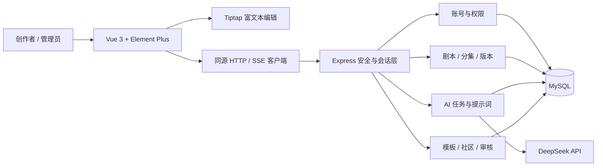
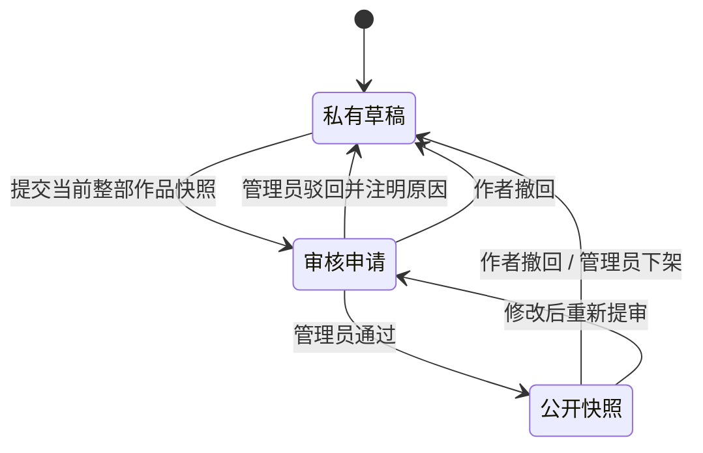

# 系统架构与业务规则

## 模块关系



## 重要的数据边界

1. 账号：密码以 bcrypt 哈希保存；浏览器只持有随机会话 Cookie。数据库存 Cookie token 的 SHA-256，禁用账号时删除全部会话。管理员接口单独检查角色。
2. 归属：私有作品、分集、历史版本、导出、个人模板与生成任务每次查询都检查登录用户 ID，不接受客户端指定作者。
3. 内容：富文本 HTML 在后端清洗；结构化文档节点与标记白名单校验。公开页面只能显示审核快照，不能显示作者正在改动的文档。
4. 时间：数据库会话统一 UTC，前端显示时间转换为 Asia/Shanghai；指标按 UTC 日期分组并在看板标明。
5. 模型：每个用户独立配置 Key，MySQL `user_ai_settings` 存储 AES-256-GCM 密文，主密钥在后端 `.local/ai-master.key`。生成任务在服务端读取当前用户配置并固定快照，不使用公共环境 Key。配置、清除、连接测试、用量汇总和调用明细均绑定会话用户，管理员也只能通过个人入口读取自己的数据。每用户同一时间一个生成任务，每小时最多 30 次；中断与失败落库。

## 剧本公开状态



数据库将 `visibility` 与 `review_status` 分开。作品已公开时重新提审，旧的已通过版本仍可阅读；通过后替换为新快照。驳回不会把未审内容发布出去。撤回公开或管理员下架立即清空公开快照，分享地址返回 404。

审核申请保存整部作品 JSON，包含当时的标题、题材、标签、简介、大纲和分集正文。审批锁定作品与审核记录，重复审批返回 409。作者之后改名、改标签或改正文都不改变待审 / 已公开快照。

## AI 多集流程

```text
校验登录、参数、Key 与并发限制
  → 持久化 running 任务
  → 创建私有作品或验证续生成作品归属
  → 生成并保存完整分集大纲
  → 按 episode_no 逐集调用模型
  → 每集完整结束后，正文与初始快照事务落库
  → 完成时将任务标记 completed
```

停止、连接关闭或上游错误会终止当次请求；已完整写出的分集保留，当前未完整分集不作为正式正文落库。任务 output 仍保留已接收的文本，失败 / 取消状态与作品 ID 可查询。继续生成时读取作品原始参数和已完成分集，跳过已有集数，避免重复生成覆盖用户稿。

AI 局部操作：先保存当前版本，再记录选区、分集 revision 和整份文档指纹，生成结果作为候选展示。应用前再次比较版本与文档；正文已经变化就拒绝覆盖。续写只插入新增段落；其余操作替换选区或整集。候选未确认时不更改正文。

## 自动保存与版本

前端 1.6 秒输入防抖，保存请求串行执行。保存时携带 revision；后端执行 `WHERE id=? AND revision=?` 更新并递增 revision，不匹配返回 409。保存进行期间的新输入不会被“已保存”误标，下一次保存继续使用最新 revision。

每次成功保存追加不可变版本。回退先备份当前正文，再把选定历史内容保存为新 revision。编辑页可以预览最近 100 个版本。刷新关闭前有未保存内容时浏览器显示离开提示，页面内切换会先尝试保存。

格式标准化把场景标题转换为 heading、角色和旁白转换为规范标签，统一冒号，不声称能够自动判断所有自然语言语义；没有标记的歧义内容仍需编剧校对。

## 主要表关系

- users → sessions / auth_tokens / oauth_accounts：会话与一次性授权。
- users → scripts → episodes → versions：作者、作品、分集与历史。
- scripts → reviews：冻结快照审核；scripts.published_json 是当前可见快照。
- users → generation_configs / ai_jobs：参数与可追踪任务。
- templates：官方或个人模板，官方无用户 owner。
- likes / favorites：联合主键实现幂等互动。
- comments / browse_history / reports：评论、去重浏览与举报。
- analytics_events / audit_logs：真实事件统计与管理员操作记录。

建表源文件为 `server/src/db/schema.sql`。本机初始化工具只在新项目独立实例中创建库和账号；迁移入口通过 `CREATE TABLE IF NOT EXISTS` 重入，不删除正式数据。后续新增字段应编写显式升级迁移，不能只改 CREATE TABLE 后假定已有数据库会自动升级。

## 部署边界

当前单实例 Node 服务适用于本地毕设演示。生产部署需使用 HTTPS、真实 APP_ORIGIN、正式 SMTP 与微信回调域名；Cookie 的 Secure 标记由 NODE_ENV 控制。大规模运行时应增加集中会话清理、事件归档、数据库备份与共享 AI 任务队列。现阶段不包含跨服务器队列、生产压测或真实第三方凭据验收。
